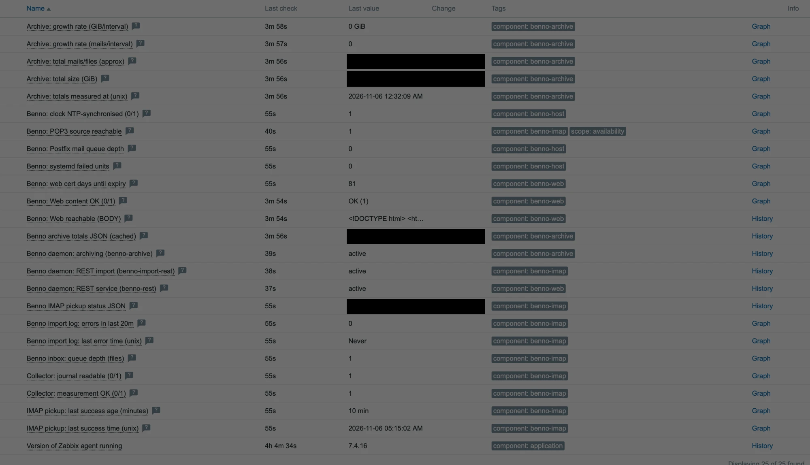
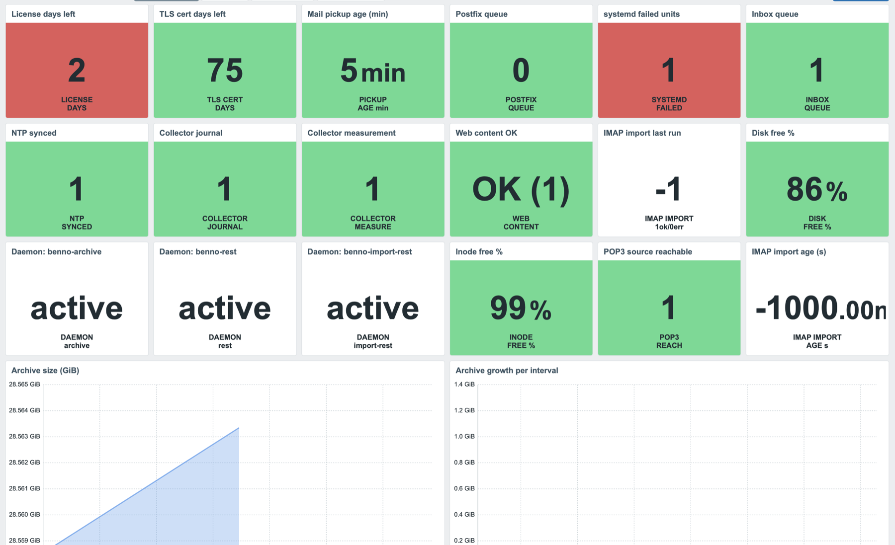
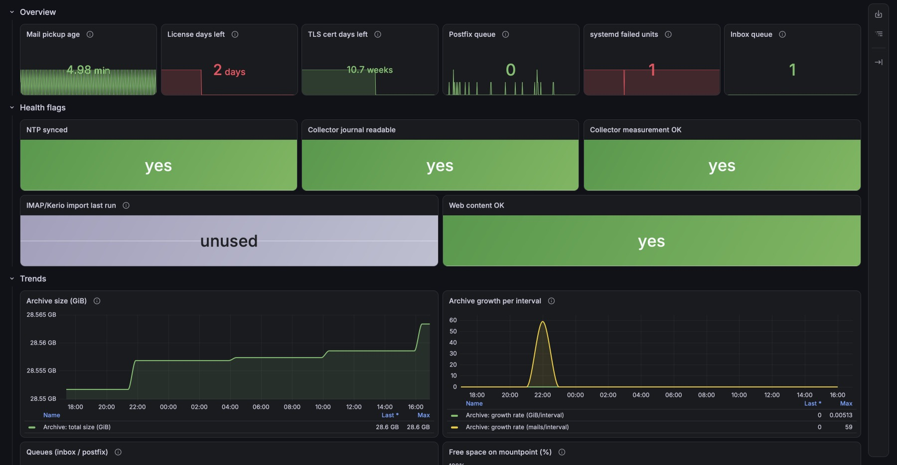

# Benno MailArchiv by Zabbix agent

*[English](README.md) · **Deutsch***

Ein Zabbix-Template zur Überwachung eines [Benno-MailArchiv](https://www.benno-mailarchiv.de/)-Servers
— der quelloffenen, revisionssicheren E-Mail-Archivierung. Es beobachtet die
Betriebssignale, die gern **lautlos** ausfallen: **ob der POP3/IMAP-Abruf noch
läuft und frisch ist**, wie das Archiv wächst, den Inbox-Rückstau, Platz/Inodes,
die Weboberfläche, die **Erreichbarkeit der POP3/IMAP-Quelle**, die **Benno-
Daemons**, das **Web-TLS-Zertifikat**, die **NTP-Zeitsynchronisation**, die
**Postfix-Queue**, **fehlgeschlagene systemd-Units**, den **Ablauf der
Benno-Lizenz**, einen optionalen **IMAP/Kerio-Import** und hängende Inbox-Dateien.

> Motivation: Ein stehengebliebener Abruf bleibt oft lange unbemerkt, weil nichts
> *einen Fehler wirft* — es kommt einfach keine Mail mehr an. Dieses Template
> macht genau diesen Zustand alarmierbar und schützt davor, dass die Überwachung
> selbst blind wird (toter Collector, unlesbares Journal, Web-Ausfall,
> steckengebliebener Archiv-Scan, ein kaputter Check, der eine falsche „Null"
> meldet).

### Was es beweist — und was nicht

Es prüft, dass der Abruf-Job **läuft** (eine frische `Fetched N files`-Zeile) und
dass das **Archiv wächst**. Es beweist **nicht** Ende-zu-Ende, dass eine bestimmte
Nachricht indexiert und auffindbar ist — dafür bräuchte es eine kontrollierte
Testmail, die bis in die Archivsuche verfolgt wird; das liegt außerhalb dieses
Templates (siehe *Grenzen*).

- **Datenerhebung:** Zabbix-**Agent 2** (passiv) plus ein HTTP-Agent-Item. Ein
  privilegierter **Root-Cron-Collector** liefert alles, was der Agent-User nicht
  lesen darf. **Aktive Checks sind nicht nötig.**
- **Autor / Vendor:** Alexander Fox | PlaNet Fox — <https://planetfox.biz>.
  Lizenz: siehe [LICENSE](LICENSE).

## Unterstützte Zabbix-Versionen

Entwickelt und im Produktivbetrieb unter **Zabbix 7.4**; die mitgelieferte Datei
ist ein 7.4-Export und importiert dort unverändert. Sie nutzt nur Item-/Trigger-
Funktionen ab **7.0**, aber Zabbix importiert einen 7.4-Export nicht auf einem
älteren Server — für **7.0 / 7.2** das Template aus einer solchen Instanz neu
exportieren (oder das `version:`-Feld anpassen und neu validieren). **8.0**
importiert den 7.4-Export sauber über die eingebaute Migration (auf 8.0.0
verifiziert). Das mitgelieferte **native Dashboard** (unten) ist **nur für
Zabbix 8.0** — die Item-/Trigger-Überwachung läuft auf 7.0/7.4, dort aber
stattdessen das Grafana-Dashboard nutzen.

## Screenshot



## Wie es funktioniert

Der Zabbix-Agent-User darf normalerweise weder das systemd-Journal noch das
Benno-Archiv-Repository oder Bennos Logs lesen. Statt diese Rechte zu vergeben,
sammelt ein **Root-Cron-Job** (`benno-zabbix-status.sh`, alle 5 Min) die Signale
und schreibt zwei JSON-Dateien in ein eigenes, **root-eigenes** State-Verzeichnis;
der Agent `cat`t sie nur noch über argumentlose UserParameters.

```
Journal / /srv/benno/* / Import-Log / TLS-Cert / systemd / Postfix / NTP
            │  (Root-Cron, alle 5 Min, single-instance per flock)
            ▼
   benno-zabbix-status.sh  ──►  /var/lib/benno-zabbix/benno_status.json
                                 /var/lib/benno-zabbix/benno_archive_total.json  (alle ~6h)
            │  cat (UserParameter, Agent liest nur)
            ▼
   zabbix_agent2  ──►  Zabbix-Server
```

`benno_status.json` trägt: `ts`, `collector_ok`, `journal_ok`, `last_ok_epoch`,
`last_ok_age`, `inbox_queue`, `pop3_err_20m`, `import_err_20m`,
`import_err_last_epoch`, `web_cert_days`, `ntp_synced`, `postfix_queue`,
`systemd_failed`, `license_days`, `imapimport_last` / `imapimport_age`,
`inbox_err_aged` / `inbox_prc_aged`. Einige Items liest der **Agent direkt**, ohne Collector: der
POP3-Erreichbarkeits-Check (`net.tcp.service`), die drei Daemon-Checks
(`systemd.unit.info`, Agent 2) und der Web-Check (HTTP-Agent).

### Explizite Unbekannt-Zustände (kein stilles „gesund")

Der Collector veröffentlicht eine fehlgeschlagene Messung nie als gesunde Null:

- `journal_ok = 0`, wenn das Journal unlesbar ist → das Abruf-Alter gilt als
  UNBEKANNT (`-1`), und ein HIGH-Trigger feuert. Niemals ein vorgetäuschtes Alter 0.
- `collector_ok = 0`, wenn eine Eingabe fehlt (z.B. das Inbox-Verzeichnis) →
  HIGH-Trigger; der Inbox-Wert ist `-1`, nicht `0`.
- `import_err_20m = -1`, wenn das Import-Log nicht lesbar ist (falscher Pfad /
  fehlt / Rechte) → eigener Trigger, damit ein kaputter Check nie mit „null Fehler"
  verwechselt wird.
- `web_cert_days = -1` / `postfix_queue = -1` kennzeichnen ein unlesbares Zertifikat
  bzw. fehlendes Postfix statt einer irreführenden `0`.
- `last_ok_age` nutzt den **echten** Zeitstempel des letzten erfolgreichen Abrufs.
- Die Archiv-Summen tragen ein `ts`; ein `fuzzytime()`-Trigger (`benno.archive.ts`)
  alarmiert, wenn der 6h-Scan steht, statt ewig die alten Zahlen zu liefern.
- Bei einem Archiv-Scan-Fehler behält der Collector die vorherigen Summen (der
  Staleness-Trigger macht es sichtbar), statt sie mit Nullen zu überschreiben.

### Import-Log-Fehler, ohne Inhalt preiszugeben

Das Import-Fehler-Signal entsteht **im Collector**, der als root läuft und das
Benno-Import-Log lesen kann (typisch `0640 benno:benno`, für den Agent-User
unlesbar). Er veröffentlicht nur eine **Zahl** — `import_err_20m`
(ERROR/FATAL/SEVERE-Zeilen der letzten 20 Min, nach Log-**Level** gematcht, nicht
per Substring) und `import_err_last_epoch`. Keine Logzeile erreicht jemals Zabbix,
somit werden **keine Mail-Metadaten der Kunden gespeichert**.

### Sicherheit

Temp-Dateien werden mit `mktemp` im root-eigenen State-Verzeichnis angelegt und
atomar umbenannt, damit kein vorhersehbarer Name als Symlink für ein
privilegiertes Überschreiben vorplatziert werden kann. Der gesamte Lauf ist per
`flock` single-instance, und Archiv-Scan wie TLS-Probe sind mit `timeout` begrenzt.

## Voraussetzungen

- Ein Benno-MailArchiv-Host mit installiertem **Zabbix-Agent 2** (Agent 2 ist für
  die `systemd.unit.info`-Daemon-Checks erforderlich). Passive Checks genügen; das
  Template nutzt keine aktiven Items.
- Auf dem Host: `flock`, `journalctl`, `du`, `find`, `timeout`, `systemctl`,
  `timedatectl`, `openssl` (Web-Cert-Check) und optional `mailq` (Postfix-Queue).
  Alles Standard auf einer systemd-Distribution mit Benno.
- Der POP3/IMAP-Abruf-Job loggt unter einer bekannten Kennung ins Journal
  (Default `benno-pop3`; im Skript konfigurierbar).
- Das Benno-Import-Log im log4j-Format (Default `/var/log/benno/archive.log`; über
  `BENNO_IMPORT_LOG` im Skript konfigurierbar).

## Installation

### 1. Auf dem Benno-Host (Agent-Seite)

**Empfohlen — der Installer** erkennt die Agent-Variante (agent2 oder klassisch
`agentd`) und ihr Include-Verzeichnis, entfernt eine ältere Kopie, die dieselben
UserParameters doppelt registrieren würde (ein Duplikat lässt den Agent nicht
mehr starten), primed den Collector, startet den richtigen Dienst neu und testet
beide Keys selbst:

```bash
sudo ./install.sh
```

<details><summary>Oder von Hand</summary>

```bash
# Root-eigenes State-Verzeichnis: nur root schreibt, der Agent liest. KEIN
# world-writable Verzeichnis wiederverwenden (Symlink-Sicherheit).
install -d -m755 -o root -g root /var/lib/benno-zabbix

install -m755 agent/benno-zabbix-status.sh /usr/local/bin/benno-zabbix-status.sh
install -m644 agent/benno-zabbix.conf      /etc/zabbix/zabbix_agent2.d/benno-zabbix.conf
install -m644 agent/benno-zabbix.cron      /etc/cron.d/benno-zabbix

# Den CONFIG-Block oben im Skript anpassen, falls deine Installation abweicht
# (BENNO_STATE_DIR, BENNO_INBOX_DIR, BENNO_ARCHIVE_DIR, BENNO_ARCHIVE_REPO_DIR,
# BENNO_POP3_IDENT, BENNO_IMPORT_LOG, BENNO_WEB_CERT_HOST — jeweils auch über die
# cron-Umgebung setzbar). BENNO_STATE_DIR muss zu den Pfaden in benno-zabbix.conf
# passen.

/usr/local/bin/benno-zabbix-status.sh      # erster Lauf (das initiale du kann eine Minute dauern)
systemctl restart zabbix-agent2

# Test (die Keys nehmen keine Argumente). Vollen Pfad nutzen — /usr/sbin ist oft
# nicht im interaktiven PATH, deshalb meldet ein nacktes `zabbix_agent2` schon mal
# „nicht gefunden":
/usr/sbin/zabbix_agent2 -t benno.status
/usr/sbin/zabbix_agent2 -t benno.archive_total
```

</details>

### 2. Im Zabbix-Frontend (Server-Seite)

1. *Data collection → Templates → Import* → `template_app_benno_mailarchiv_agent.yaml`,
   *Create new* und *Update existing* für Templates/Items/Triggers aktivieren. Das
   mitgelieferte native Dashboard importiert und rendert **nur unter Zabbix 8.0**
   (siehe [Dashboard](#dashboard)).
2. Das Template mit deinem Benno-Host verknüpfen.
3. Die Host-Macros unten setzen. Mindestens `{$BENNO_MOUNTPOINT}` (das
   Archiv-Dateisystem), `{$BENNO_WEB_URL}` (die Web-UI-URL) und `{$BENNO_POP3_HOST}`
   (der POP3/IMAP-Server, von dem der Host abruft — darauf zielt der
   Erreichbarkeits-Check).

## Macros

Schwellwerte, der Web-Check und die POP3-Quelle liegen in Macros. **Collector-Pfade
werden im Skript konfiguriert, nicht per Macro** — die UserParameters nehmen keine
Argumente.

| Macro | Default | Zweck |
|---|---|---|
| `{$BENNO_MOUNTPOINT}` | `/` | Dateisystem des Archivs (z.B. auf `/srv` setzen). |
| `{$BENNO_WEB_URL}` | `http://localhost/benno/` | Benno-Web-UI-URL (siehe *Web-Check* — läuft vom **Server/Proxy**). |
| `{$BENNO_WEB_REGEX}` | `(Benno\|MailArchive\|benno)` | Erwarteter Inhalt der Seite. Spezifisch für Benno halten. |
| `{$BENNO_WEB_TIMEOUT}` | `10s` | Timeout des Web-Checks. |
| `{$BENNO_POP3_HOST}` | `mail.example.com` | POP3/IMAP-Quelle für den Erreichbarkeits-Check. Der Default ist ein **Platzhalter** — solange unverändert, **schweigt** der Trigger (kein Fehlalarm beim Verknüpfen); auf den echten Server setzen, um den Check zu aktivieren. Nur Erreichbarkeit, keine Zugangsdaten. |
| `{$BENNO_POP3_PORT}` | `995` | Port der Quelle (995 = POP3S, 993 = IMAPS, 143 = IMAP, 110 = POP3). |
| `{$BENNO_INBOX_STUCK_WARN}` | `0` | Alarm über so vielen gealterten `.err`/`.prc`-Dateien im Inbox (0 = jede). Alters-Fenster im Collector (`BENNO_INBOX_STUCK_HOURS`, Default 2 h). |
| `{$BENNO_CERT_WARN_DAYS}` | `10` | Alarm, wenn das Web-TLS-Zertifikat weniger Tage Restlaufzeit hat. |
| `{$BENNO_LICENSE_WARN_DAYS}` | `30` | Alarm, wenn die Benno-Lizenz weniger Tage Restlaufzeit hat. |
| `{$BENNO_IMAPIMPORT_MAXAGE}` | `1800` | Alarm, wenn der IMAP/Kerio-Import-Wrapper so viele Sekunden nicht gelaufen ist (nur wo dessen Log existiert). |
| `{$BENNO_IMPORT_ERR_WARN}` | `0` | Alarm über so vielen Import-Log-Fehlern in 20 Min (0 = jeder Fehler alarmiert). |
| `{$BENNO_POSTFIX_QUEUE_WARN}` | `50` | Alarm, wenn die Postfix-Queue diese Nachrichtenzahl übersteigt. |
| `{$BENNO_SYSTEMD_FAILED_WARN}` | `0` | Alarm über so vielen fehlgeschlagenen systemd-Units (0 = jede). |
| `{$BENNO_BACKUP_MAX_AGE}` | `93600` | Alarm, wenn so viele Sekunden kein erfolgreiches Backup lief (Default 26 h). Still, solange `BENNO_BACKUP_STAMP` im Collector nicht gesetzt ist (siehe unten). |
| `{$BENNO_LAST_OK_MAX}` | `60` | Alarm, wenn so viele Minuten kein erfolgreicher Abruf war. |
| `{$BENNO_INBOX_QUEUE_WARN}` / `_CRIT` | `100` / `500` | Inbox-Rückstau-Schwellwerte (Dateien). |
| `{$BENNO_DISK_PFREE_WARN}` / `_CRIT` | `15` / `5` | Freier-Platz-Schwellwerte (%). |
| `{$BENNO_INODE_PFREE_WARN}` / `_CRIT` | `10` / `3` | Freie-Inodes-Schwellwerte (%). |
| `{$BENNO_ARCHIVE_CACHE_MAX_AGE}` | `21600` | Collector-Scan-Intervall (auf Zabbix-Seite informativ). |
| `{$BENNO_ARCHIVE_TS_MAX}` | `28800` | Alarm, wenn die Archiv-Summen nicht innerhalb so vieler Sekunden aktualisiert wurden (> Scan-Intervall). |

Zwei optionale Collector-Schalter (im Skript oder dessen cron-Umgebung, kein Makro):

- **`BENNO_BACKUP_STAMP`** — Pfad zu einer Datei, die dein Backup-Job bei Erfolg
  `touch`t (jedes Tool: PBS, Borg, restic, rsync, tar). Der Collector meldet ihr
  Alter als `benno.backup_age`; ungesetzt/fehlend → `-1`, und der Stale-Backup-
  Trigger bleibt still — kostet nichts, bis ein Backup verdrahtet ist.
- **`BENNO_SYSTEMD_IGNORE`** — kommaseparierte failed-Units, die aus dem Zähler
  `systemd failed units` fallen (z. B. eine `chkrootkit.service`-Exit-Code-Marotte).
  Prüfe *warum* eine Unit failed, bevor du sie stummschaltest — erst recht eine
  Sicherheits-Unit.

## Items und Trigger

Collector-gestützt (abhängig von `benno.status` / `benno.archive_total`):
`benno.imap.last_ok_age` / `_epoch`, `benno.inbox_queue`, `benno.journal_ok`,
`benno.collector_ok`, `benno.archive.total_bytes` / `_files` / `growth_*` / `ts`,
`benno.import.err_20m` / `err_last`, `benno.web.cert_days`, `benno.ntp_synced`,
`benno.postfix_queue`, `benno.systemd_failed`, `benno.license_days`,
`benno.imapimport.last` / `.age`, `benno.inbox.err_aged` / `.prc_aged`. Direkt vom
Agent:
`net.tcp.service[...]` (POP3-Erreichbarkeit), `systemd.unit.info[...]` ×3
(Benno-Daemons), `benno.web.body` + `benno.web.content_ok` (HTTP-Agent),
`vfs.fs.size` / `vfs.fs.inode`.

| Schwere | Trigger |
|---|---|
| HIGH | Kein erfolgreicher IMAP-Abruf seit > `{$BENNO_LAST_OK_MAX}` Min |
| HIGH | Status-Collector steht oder ist tot (leerer Wert oder nodata) |
| HIGH | Collector kann das Journal nicht lesen (Abruf-Zustand **unbekannt**) |
| HIGH | Collector konnte seine Eingaben nicht messen |
| HIGH | POP3-Quelle 10 Min unerreichbar (Mailabruf wird stehenbleiben) |
| HIGH | Benno-Daemon down — archiving / REST-Service; optionaler REST-Import nur bei Crash |
| HIGH | Web-UI-Inhaltscheck fehlgeschlagen |
| HIGH | Web-UI unerreichbar (keine Daten — HTTP 500 / Timeout / refused / DNS) |
| HIGH | Web-TLS-Zertifikat läuft ab (< `{$BENNO_CERT_WARN_DAYS}` Tage) |
| HIGH | Benno-Lizenz läuft ab (< `{$BENNO_LICENSE_WARN_DAYS}` Tage) |
| HIGH | systemd hat fehlgeschlagene Units |
| DISASTER / WARNING | Inbox-Queue kritisch / wächst |
| DISASTER / WARNING | Freier Platz kritisch / niedrig |
| DISASTER / WARNING | Freie Inodes kritisch / niedrig |
| WARNING | Archiv-Summen sind veraltet (Scan steht) |
| WARNING | Import-Log meldet Fehler (letzte 20 Min) |
| WARNING | Import-Log-Fehlercheck sammelt nicht (`-1`) |
| WARNING | Systemuhr nicht NTP-synchronisiert |
| WARNING | Postfix-Mailqueue staut sich |
| HIGH | IMAP/Kerio-Import steht — seit > `{$BENNO_IMAPIMPORT_MAXAGE}` s nicht gelaufen |
| WARNING | IMAP/Kerio-Import letzter Lauf fehlgeschlagen (`[ERROR]`) |
| WARNING | Hängende `.err`-Dateien im Inbox (Archivierung fehlgeschlagen) |
| WARNING | Hängende `.prc`-Dateien im Inbox (Verarbeitung hängt) |

Eskalation: Die WARNING-Trigger für Platz/Inodes/Inbox hängen von ihrem
KRITISCH-Gegenstück ab, sodass ein sich verschlechternder Wert von WARNING →
DISASTER eskaliert, statt den kritischen Alarm zu unterdrücken.

## Die Checks, die Host-Kontext brauchen

- **Web-Check.** `benno.web.body` ist ein **HTTP-Agent**-Item: es läuft vom
  **Zabbix-Server (oder dem Proxy des Hosts)**, nicht vom Benno-Host. `{$BENNO_WEB_URL}`
  auf eine von dort erreichbare URL richten, nicht auf `localhost` (außer der Server
  selbst liefert Benno aus). Für HTTPS setzt es `verify_peer`/`verify_host` auf YES;
  `{$BENNO_WEB_REGEX}` spezifisch halten, damit eine fremde Login-Seite nicht als
  Erfolg zählt. Eine fehlende/fehlerhafte Antwort fängt der *keine-Daten*-Trigger.
- **POP3-Erreichbarkeit.** `net.tcp.service[tcp,{$BENNO_POP3_HOST},{$BENNO_POP3_PORT}]`
  läuft auf dem Benno-Host und ist eine **Früh**warnung: ein geblockter Egress-Port
  oder ein Bann auf dem Mailserver zeigt sich hier, bevor der „>60 Min kein
  Abruf"-Alarm feuert. `{$BENNO_POP3_HOST}` auf den echten Server setzen.
- **TLS-Zertifikat.** Der Collector liest das Zertifikat lokal auf Port 443 (SNI aus
  `BENNO_WEB_CERT_HOST`, Default der FQDN des Hosts) und veröffentlicht die
  Restlaufzeit in Tagen, sodass ein Erneuerungsfehler proaktiv erkannt wird — nicht
  erst, wenn der browser-seitige Check bricht.

## Grenzen / noch nicht abgedeckt

- **Kein Ende-zu-Ende-Archivierungsbeweis.** Abruf-Frische + Archiv-Wachstum werden
  überwacht; eine kontrollierte Testmail-bis-Suche-Probe ist nicht enthalten.
- **Eine Abruf-Kennung.** Die Gesundheit leitet sich aus einer Journal-Kennung ab;
  ein Ausfall pro Konto/Mandant kann hinter den Erfolgen anderer Konten verborgen bleiben.
- **7.0-Export** ist nicht enthalten (nur 7.4-Format).
- **Betriebliche Aufteilung.** Schnelle und langsame Erhebung teilen sich ein Skript
  (single-instance gesperrt, Scan zeitbegrenzt); eine Aufteilung per systemd-Timer
  wäre bei großer Skala sauberer.
- **Archiv-Zähler** nutzen `du -sb` (apparent size) und einen rohen Dateizähler des
  Repositorys; die Mail-Anzahl ist näherungsweise und nicht Benno-Format-bewusst.

## Dashboard

Das Template bringt ein **natives Zabbix-Dashboard** mit — nach dem Verknüpfen
unter *Monitoring → Hosts → dein Host → Dashboards → „Benno MailArchiv"*. Kein
Plugin, keine Datenquelle nötig. Mit Status-Kacheln (Lizenz-/Cert-Tage,
Pickup-Alter, Queues, systemd-failed, Daemon-`ActiveState`, Health-Flags) und
Trend-Graphen für Archivgröße/-wachstum, Queues und freien Disk-/Inode-Platz.
**Erfordert Zabbix 8.0** (auf 8.0.0 verifiziert) — auf 7.0/7.4 nicht
unterstützt; dort das Grafana-Dashboard nutzen.



## Grafana-Dashboard (optional)

Ein import-fertiges Grafana-Dashboard liegt in [`grafana/`](grafana/). Es liest
dieselben Items über die
[grafana-zabbix](https://grafana.com/grafana/plugins/alexanderzobnin-zabbix-app/)-Datenquelle
— braucht also dieses Plugin, einen read-only Zabbix-API-Benutzer und einen
Benno-Host, an dem dieses Template bereits hängt (die Panels referenzieren die
Items über ihren Namen). Es ist reine Visualisierung — alarmiert wird weiterhin
über die Zabbix-Trigger. Beim Import wählst du deine Zabbix-Datenquelle; den Host
wählst du dann oben im **Host**-Dropdown — es listet die Benno-Host(s), die die
Datenquelle sieht. Nichts ist auf einen bestimmten Host oder Standort
festverdrahtet.



## Lizenz

Siehe [LICENSE](LICENSE). Bei einem Beitrag zu
[zabbix/community-templates](https://github.com/zabbix/community-templates) gelten
dessen Beitragsbedingungen.
