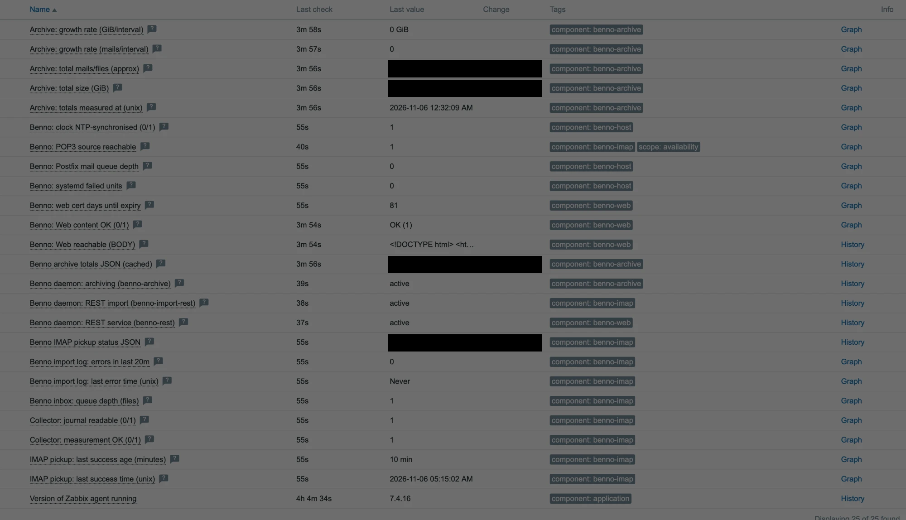

# Benno MailArchiv by Zabbix agent

***English** · [Deutsch](README.de.md)*

A Zabbix template to monitor a [Benno MailArchiv](https://www.benno-mailarchiv.de/en)
server — the open-source, revision-safe email archiving solution. It watches the
operational signals that tend to fail quietly: **whether the POP3/IMAP pickup is
still running and fresh**, how the archive grows, the inbox backlog, disk/inode
headroom, the web UI, the **reachability of the POP3/IMAP source**, the **Benno
daemons**, the **web TLS certificate**, **NTP time sync**, the **Postfix queue**,
**failed systemd units**, the **Benno license** expiry and an optional
**IMAP/Kerio import** job, and stuck inbox files.

> Motivation: a stalled pickup can go unnoticed for a long time because nothing
> *errors* — new mail simply stops arriving. This template makes that condition
> alert, and guards against the monitoring itself going blind (stale collector,
> unreadable journal, web outage, stalled archive scan, a broken check reporting
> a false "zero").

### What it does and does not prove

It verifies that the fetch job **runs** (a recent `Fetched N files` line) and that
the **archive grows**. It does **not** prove end-to-end that a given message was
indexed and is retrievable — that needs a controlled test mail traced into
archive search, which is out of scope for this template (see *Limitations*).

- **Data collection:** Zabbix **agent 2** (passive) plus one HTTP agent item. A
  privileged **root cron collector** supplies everything the agent user may not
  read. **No active checks are required.**
- **Author / vendor:** Alexander Fox | PlaNet Fox — <https://planetfox.biz>.
  License: see [LICENSE](LICENSE).

## Supported Zabbix versions

Developed and running in production on **Zabbix 7.4**; the shipped file is a 7.4
export and imports as-is there. It uses only item/trigger features available since
**7.0**, but Zabbix will not import a 7.4 export on an older server — for **7.0 /
7.2**, re-export the template from such an instance (or adjust the `version:` field
and re-validate). **8.0** imports the 7.4 export cleanly via Zabbix's built-in
migration (verified on 8.0.0).

## Screenshot



## How it works

The Zabbix agent user normally may not read the systemd journal, the Benno
archive repository or Benno's logs. Instead of granting those privileges, a
**root cron job** (`benno-zabbix-status.sh`, every 5 min) gathers the signals and
writes two JSON files into a dedicated **root-owned** state dir; the agent only
`cat`s them via argument-less UserParameters.

```
journal / /srv/benno/* / import log / TLS cert / systemd / postfix / NTP
            │  (root cron, every 5 min, single-instance via flock)
            ▼
   benno-zabbix-status.sh  ──►  /var/lib/benno-zabbix/benno_status.json
                                 /var/lib/benno-zabbix/benno_archive_total.json  (refreshed ~6h)
            │  cat (UserParameter, agent reads only)
            ▼
   zabbix_agent2  ──►  Zabbix server
```

`benno_status.json` carries: `ts`, `collector_ok`, `journal_ok`, `last_ok_epoch`,
`last_ok_age`, `inbox_queue`, `pop3_err_20m`, `import_err_20m`,
`import_err_last_epoch`, `web_cert_days`, `ntp_synced`, `postfix_queue`,
`systemd_failed`, `license_days`, `imapimport_last` / `imapimport_age`,
`inbox_err_aged` / `inbox_prc_aged`. A handful of items are read **directly by the
agent** and need no collector: the POP3-source reachability check
(`net.tcp.service`), the three daemon checks (`systemd.unit.info`, agent 2) and the
web-UI check (HTTP agent).

### Explicit unknown states (no silent "healthy")

The collector never publishes a failed measurement as a healthy zero:

- `journal_ok = 0` when the journal is unreadable → pickup age is reported as
  UNKNOWN (`-1`), and a HIGH trigger fires. It never fakes age 0.
- `collector_ok = 0` when an input (e.g. the inbox dir) is missing → HIGH trigger;
  the inbox value is `-1`, not `0`.
- `import_err_20m = -1` when the import log cannot be read (wrong path / missing /
  permissions) → its own trigger, so a broken check is never mistaken for "zero
  errors".
- `web_cert_days = -1` / `postfix_queue = -1` mark an unreadable certificate or a
  missing Postfix, rather than a misleading `0`.
- `last_ok_age` uses the **real** timestamp of the last successful fetch.
- The archive totals carry a `ts`; a `fuzzytime()` trigger (`benno.archive.ts`)
  alerts if the 6h scan stalls, instead of serving the same old numbers forever.
- On an archive-scan error the collector keeps the previous totals (so the
  staleness trigger surfaces it) rather than overwriting them with zeros.

### Import-log errors without leaking content

The import-error signal is produced **in the collector**, which runs as root and
can read the Benno import log (typically `0640 benno:benno`, which the agent user
cannot). It publishes only a **count** — `import_err_20m` (ERROR/FATAL/SEVERE
lines in the last 20 min, matched by log **level**, not a substring) and
`import_err_last_epoch`. No log line ever reaches Zabbix, so **no customer mail
metadata is retained**.

### Safety

Temp files are created with `mktemp` in the root-owned state dir and renamed
atomically, so a predictable name cannot be pre-planted as a symlink for a
privileged overwrite. The whole run is single-instance via `flock`, and the
archive scan and the TLS probe are bounded with `timeout`.

## Requirements

- A Benno MailArchiv host with the **Zabbix agent 2** installed (agent 2 is
  required for the `systemd.unit.info` daemon checks). Passive checks are enough;
  the template uses no active items.
- On the host: `flock`, `journalctl`, `du`, `find`, `timeout`, `systemctl`,
  `timedatectl`, `openssl` (web-cert check) and, optionally, `mailq` (Postfix
  queue). All standard on a systemd distro running Benno.
- The POP3/IMAP fetch job logs to the journal under a known identifier
  (default `benno-pop3`; configurable in the script).
- The Benno import log in log4j format (default `/var/log/benno/archive.log`;
  configurable via `BENNO_IMPORT_LOG` in the script).

## Installation

### 1. On the Benno host (agent side)

```bash
# Root-owned state dir: only root writes, the agent reads. Do NOT reuse a
# world-writable dir (symlink-safety).
install -d -m755 -o root -g root /var/lib/benno-zabbix

install -m755 agent/benno-zabbix-status.sh /usr/local/bin/benno-zabbix-status.sh
install -m644 agent/benno-zabbix.conf      /etc/zabbix/zabbix_agent2.d/benno-zabbix.conf
install -m644 agent/benno-zabbix.cron      /etc/cron.d/benno-zabbix

# Adjust the CONFIG block at the top of the script if your install differs
# (BENNO_STATE_DIR, BENNO_INBOX_DIR, BENNO_ARCHIVE_DIR, BENNO_ARCHIVE_REPO_DIR,
# BENNO_POP3_IDENT, BENNO_IMPORT_LOG, BENNO_WEB_CERT_HOST — each can also be set
# in the cron environment). BENNO_STATE_DIR must match the paths in
# benno-zabbix.conf.

/usr/local/bin/benno-zabbix-status.sh      # first run (the initial du may take a minute)
systemctl restart zabbix-agent2

# Test (keys take no arguments):
zabbix_agent2 -t benno.status
zabbix_agent2 -t benno.archive_total
```

### 2. On the Zabbix frontend (server side)

1. *Data collection → Templates → Import* → `template_app_benno_mailarchiv_agent.yaml`,
   enable *Create new* and *Update existing* for templates/items/triggers.
2. Link the template to your Benno host.
3. Set the host macros below. At minimum set `{$BENNO_MOUNTPOINT}` (the archive
   filesystem), `{$BENNO_WEB_URL}` (the web-UI URL) and `{$BENNO_POP3_HOST}` (the
   POP3/IMAP server the host fetches from — the reachability check targets it).

## Macros

Thresholds, the web check and the POP3 source live in macros. **Collector paths
are configured in the script, not via macros** — the UserParameters take no
arguments.

| Macro | Default | Purpose |
|---|---|---|
| `{$BENNO_MOUNTPOINT}` | `/` | Filesystem that holds the archive (set to e.g. `/srv`). |
| `{$BENNO_WEB_URL}` | `http://localhost/benno/` | Benno web UI URL (see *Web check* — runs from the **server/proxy**). |
| `{$BENNO_WEB_REGEX}` | `(Benno\|MailArchive\|benno)` | Expected content on that page. Keep it specific to Benno. |
| `{$BENNO_WEB_TIMEOUT}` | `10s` | Web check timeout. |
| `{$BENNO_POP3_HOST}` | `mail.example.com` | POP3/IMAP source for the reachability check. The default is a **placeholder** — while it is left unchanged the reachability trigger stays **silent**, so linking the template raises no false alarm; set it to the real server to activate the check. Reachability only, no credentials. |
| `{$BENNO_POP3_PORT}` | `995` | Port of that source (995 = POP3S, 993 = IMAPS, 143 = IMAP, 110 = POP3). |
| `{$BENNO_INBOX_STUCK_WARN}` | `0` | Alert above this many aged `.err`/`.prc` files in the inbox (0 = any). Age window is set in the collector (`BENNO_INBOX_STUCK_HOURS`, default 2 h). |
| `{$BENNO_CERT_WARN_DAYS}` | `10` | Alert when the web TLS cert has fewer than this many days left. |
| `{$BENNO_LICENSE_WARN_DAYS}` | `30` | Alert when the Benno license has fewer than this many days left. |
| `{$BENNO_IMAPIMPORT_MAXAGE}` | `1800` | Alert when the IMAP/Kerio import wrapper has not run for this many seconds (only where its log exists). |
| `{$BENNO_IMPORT_ERR_WARN}` | `0` | Alert above this many import-log errors in 20 min (0 = any error alerts). |
| `{$BENNO_POSTFIX_QUEUE_WARN}` | `50` | Alert when the Postfix queue exceeds this many messages. |
| `{$BENNO_SYSTEMD_FAILED_WARN}` | `0` | Alert above this many failed systemd units (0 = any). |
| `{$BENNO_LAST_OK_MAX}` | `60` | Alert if no successful pickup for this many minutes. |
| `{$BENNO_INBOX_QUEUE_WARN}` / `_CRIT` | `100` / `500` | Inbox backlog thresholds (files). |
| `{$BENNO_DISK_PFREE_WARN}` / `_CRIT` | `15` / `5` | Free-disk thresholds (%). |
| `{$BENNO_INODE_PFREE_WARN}` / `_CRIT` | `10` / `3` | Free-inode thresholds (%). |
| `{$BENNO_ARCHIVE_CACHE_MAX_AGE}` | `21600` | Collector scan interval (informational on the Zabbix side). |
| `{$BENNO_ARCHIVE_TS_MAX}` | `28800` | Alert if archive totals have not refreshed within this many seconds (> scan interval). |

## Items and triggers

Collector-backed (dependent on `benno.status` / `benno.archive_total`):
`benno.imap.last_ok_age` / `_epoch`, `benno.inbox_queue`, `benno.journal_ok`,
`benno.collector_ok`, `benno.archive.total_bytes` / `_files` / `growth_*` / `ts`,
`benno.import.err_20m` / `err_last`, `benno.web.cert_days`, `benno.ntp_synced`,
`benno.postfix_queue`, `benno.systemd_failed`, `benno.license_days`,
`benno.imapimport.last` / `.age`, `benno.inbox.err_aged` / `.prc_aged`. Read
directly by the agent:
`net.tcp.service[...]` (POP3 reachability), `systemd.unit.info[...]` ×3 (Benno
daemons), `benno.web.body` + `benno.web.content_ok` (HTTP agent),
`vfs.fs.size` / `vfs.fs.inode`.

| Severity | Trigger |
|---|---|
| HIGH | No successful IMAP pickup for > `{$BENNO_LAST_OK_MAX}` min |
| HIGH | Status collector stale or dead (empty value or nodata) |
| HIGH | Collector cannot read the journal (pickup state **unknown**) |
| HIGH | Collector could not measure its inputs |
| HIGH | POP3 source unreachable for 10 min (mail pickup will stall) |
| HIGH | Benno daemon down — archiving / REST service; optional REST import only on crash |
| HIGH | Web UI content check failed |
| HIGH | Web UI unreachable (no data — HTTP 500 / timeout / refused / DNS) |
| HIGH | Web TLS certificate expiring (< `{$BENNO_CERT_WARN_DAYS}` days) |
| HIGH | Benno license expiring (< `{$BENNO_LICENSE_WARN_DAYS}` days) |
| HIGH | systemd has failed units |
| DISASTER / WARNING | Inbox queue critical / growing |
| DISASTER / WARNING | Disk free critical / low |
| DISASTER / WARNING | Inode free critical / low |
| WARNING | Archive totals are stale (scan stalled) |
| WARNING | Import log reports errors (last 20 min) |
| WARNING | Import-log error check not collecting (`-1`) |
| WARNING | System clock not NTP-synchronised |
| WARNING | Postfix mail queue backing up |
| HIGH | IMAP/Kerio import stalled — not run for > `{$BENNO_IMAPIMPORT_MAXAGE}` s |
| WARNING | IMAP/Kerio import last run failed (`[ERROR]`) |
| WARNING | Stuck `.err` files in the inbox (failed archiving) |
| WARNING | Stuck `.prc` files in the inbox (hung processing) |

Escalation: the WARNING triggers for disk/inode/inbox depend on their CRITICAL
counterpart, so a worsening value escalates WARNING → DISASTER rather than the
critical alert being suppressed.

## The checks that need host context

- **Web check.** `benno.web.body` is an **HTTP agent** item: it runs from the
  **Zabbix server (or the host's proxy)**, not from the Benno host. Point
  `{$BENNO_WEB_URL}` at a URL reachable from there, not at `localhost` unless the
  server itself serves Benno. For HTTPS it sets `verify_peer`/`verify_host` to
  YES; keep `{$BENNO_WEB_REGEX}` specific so a foreign login page is not counted
  as success. A missing/failing response is caught by the *no data* trigger.
- **POP3 reachability.** `net.tcp.service[tcp,{$BENNO_POP3_HOST},{$BENNO_POP3_PORT}]`
  runs on the Benno host and is an **early** warning: a blocked egress port or a
  ban on the mail server shows here before the ">60 min no pickup" alert. Set
  `{$BENNO_POP3_HOST}` to the real server.
- **TLS certificate.** The collector reads the cert locally on port 443 (SNI from
  `BENNO_WEB_CERT_HOST`, default the host's FQDN) and publishes days-to-expiry, so
  a renewal failure is caught proactively, not after the browser-facing check
  breaks.

## Limitations / not yet covered

- **No end-to-end archiving proof.** Pickup freshness + archive growth are
  monitored; a controlled test-mail-to-search probe is not included.
- **Single fetch identifier.** Health is derived from one journal identifier; a
  per-account/tenant failure can be hidden behind other accounts' successes.
- **7.0 export** is not shipped (only 7.4 format).
- **Operational split.** Fast and slow collection share one script (single-instance
  locked, scan time-bounded); a systemd-timer split would be cleaner at large scale.
- **Archive counters** use `du -sb` (apparent size) and a raw file count of the
  repository; the mail count is approximate and not Benno-format-aware.

## License

See [LICENSE](LICENSE). If contributed to
[zabbix/community-templates](https://github.com/zabbix/community-templates), it
follows that repository's contribution terms.
